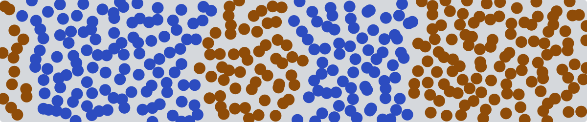

<a href="https://kourosh-h.github.io">
  <picture>
    <source media="(prefers-color-scheme: dark)" srcset="banner-dark.svg">
    
  </picture>
</a>

### Kourosh Hasheminejad

I am a computational materials scientist with a doctorate (D.Sc., 2026) from Aalto University, Finland. I work on computer simulations of soft matter, coatings, interfaces, composites, metals, and other materials, from single atoms up to the mesoscale.

#### My website: [kourosh-h.github.io](https://kourosh-h.github.io)

It has my papers explained with figures that run in the browser, simulations for industry, teaching material, and all my projects.

In my doctoral work, I used all-atom molecular dynamics, coarse-grained models, and dissipative particle dynamics (DPD) to design block copolymer coatings for paper. Before that, I worked on polymer/graphene composites, and my first degree was in metallurgy.

- **Research.** Coatings, monolayers on silica, and polymer/graphene interfaces. For the monolayers, I wrote [apadana](https://github.com/Kourosh-h/apadana-v4), a Python package with a command-line tool that builds the models and every file needed to run them in GROMACS.
- **Industry.** I worked on the simulations in coating projects with Kemira, and I enjoy work where simulations help to decide what to make next.
- **Teaching.** I developed course material for Soft Materials Modelling and Computational Chemistry I, advised five B.Sc. theses, and I write explainers with simulations that run in the browser.
- **Machine learning.** This is a growing part of my work, and I am building it up as a series of projects on molecules and simulations.

The picture at the top is a small DPD simulation of two kinds of beads that separate, made with a short NumPy script. It also opens my website.

**Links:** [website](https://kourosh-h.github.io) · [LinkedIn](https://fi.linkedin.com/in/kourosh-hasheminejad-2577001aa/) · [Google Scholar](https://scholar.google.com/citations?user=Ey7-XMsAAAAJ) · [ORCID](https://orcid.org/0000-0002-5230-0350) · [CV](https://github.com/Kourosh-h/cv/releases/download/cv/cv.pdf)

#### On my website

- [Research](https://kourosh-h.github.io/research.html): my eight papers, each explained with a figure that runs in the browser
- [Simulations for industry](https://kourosh-h.github.io/industry.html): how molecular models can help R&D teams, with examples from nine industries
- [Learn](https://kourosh-h.github.io/learn.html): explainers on MD, statistical mechanics, analysis, coarse-graining, DPD, enhanced sampling, and more, in five tracks
- [Playground](https://kourosh-h.github.io/playground.html): 44 small simulations and machine learning demos that run in the browser
- [Bead Lab](https://kourosh-h.github.io/bead-lab.html): an iPhone app with eight simulations that run live on the phone, from a Lennard-Jones liquid to Gray-Scott patterns
- [Projects](https://kourosh-h.github.io/projects.html): 35 numbered projects, 13 small simulations, 13 analysis tools, and a few extras, which you can filter and search

#### Peer-reviewed papers

- Hydration-enhanced chain length effects in short alkyl chain self-assembled monolayers on silica. **K. Hasheminejad**, D. Tolmachev, M. Sammalkorpi. Submitted to *J. Colloid Interface Sci.*, in review (2026). [explained](https://kourosh-h.github.io/research.html#p4)
- Molecular level dependencies of water permeability in di-block copolymer assemblies. **K. Hasheminejad**, Y. Morais Jaques, A. Lepo, A. Scacchi, M. Sammalkorpi. *Comput. Mater. Sci.* 258, 114046 (2025). [doi](https://doi.org/10.1016/j.commatsci.2025.114046) · [explained](https://kourosh-h.github.io/research.html#p3)
- Cracking polymer coatings of paper-like surfaces: Control via block co-polymer structure and system composition. **K. Hasheminejad**, A. Scacchi, S. Javan Nikkhah, M. Sammalkorpi. *Appl. Surf. Sci.* 640, 158324 (2023). [doi](https://doi.org/10.1016/j.apsusc.2023.158324) · [explained](https://kourosh-h.github.io/research.html#p2)
- Controlling self-assembling co-polymer coatings of hydrophilic polysaccharide substrates via co-polymer block length ratio. A. Scacchi, **K. Hasheminejad**, S. Javan Nikkhah, M. Sammalkorpi. *J. Colloid Interface Sci.* 640, 809-819 (2023). [doi](https://doi.org/10.1016/j.jcis.2023.02.117) · [explained](https://kourosh-h.github.io/research.html#p1)
- Engineering the shape memory parameters of graphene/polymer nanocomposites through atomistic simulations: On the effect of nanofiller surface treatment. M. Amini, **K. Hasheminejad**, A. Montazeri. *Smart Mater. Struct.* 31, 025010 (2022). [doi](https://doi.org/10.1088/1361-665X/ac4194) · [explained](https://kourosh-h.github.io/research.html#p8)
- Tailoring adhesion characteristics of poly(L-lactic acid)/graphene nanocomposites by end-grafted polymer chains: An atomic-level study. **K. Hasheminejad**, A. Montazeri, H. Hasheminejad. *Eur. Polym. J.* 148, 110351 (2021). [doi](https://doi.org/10.1016/j.eurpolymj.2021.110351) · [explained](https://kourosh-h.github.io/research.html#p6)
- Experimentally guided MD simulation to enhance the shape memory behavior of polymer-based nanocomposites: Towards elaborating the underlying mechanism. M. Amini, **K. Hasheminejad**, A. Montazeri. *Compos. Part A* 138, 106055 (2020). [doi](https://doi.org/10.1016/j.compositesa.2020.106055) · [explained](https://kourosh-h.github.io/research.html#p7)
- Enhanced interfacial characteristics in PLA/graphene composites through numerically-designed interface treatment. **K. Hasheminejad**, A. Montazeri. *Appl. Surf. Sci.* 502, 144150 (2020). [doi](https://doi.org/10.1016/j.apsusc.2019.144150) · [explained](https://kourosh-h.github.io/research.html#p5)

#### Doctoral thesis

- Computational modelling of block copolymer surface coatings at multiple length scales. Aalto University (2026). [full text](https://urn.fi/URN:ISBN:978-952-64-2955-7) · [explained](https://kourosh-h.github.io/research.html#thesis)

#### Research-related code

**[apadana](https://github.com/Kourosh-h/apadana-v4)** is my main coding work. It is a Python package that builds all-atom models of alkylsilane monolayers on silica, for any chain length and coverage, and writes every file needed to simulate them with GROMACS. This includes the topology and force field files, the run parameters of every dry and wet stage, and job scripts for SLURM. It also has a command-line tool, so a whole series of systems can be built without writing Python. For example, this line builds ten systems, which are all combinations of five chain lengths and two coverages, four at a time:

```bash
apadana build --chain-length 4 5 6 7 8 --coverage 0.45 2.40 --seed 1 --processes 4
```

- [surface-water-dynamics-ml](https://github.com/Kourosh-h/surface-water-dynamics-ml): water dynamics at surfaces from MD, sorted into regimes with k-means
- [Si-C_bond_parameterization_for_CHARMM](https://github.com/Kourosh-h/Si-C_bond_parameterization_for_CHARMM): Si-C bond parameters for CHARMM, from ORCA calculations
- [Si-C_force_field_validation](https://github.com/Kourosh-h/Si-C_force_field_validation): the force field terms at the Si-C bond of alkylsilane monolayers, checked against relaxed ORCA scans, and the whole force field as one GROMACS folder
- [mace-rmd17-ethanol](https://github.com/Kourosh-h/mace-rmd17-ethanol): a learning project on ML potentials, where I reproduced the MACE result for ethanol on a laptop CPU, with ORCA checks of the reference data and of the MD

#### Simulation methods

- **Methods I use.** All-atom molecular dynamics (MD) in GROMACS and LAMMPS, coarse-grained MD, and dissipative particle dynamics (DPD), which together take a system from single molecules up to whole films. I use quantum chemistry in ORCA to fit and check force field terms, and I analyze structure and dynamics, from order parameters and density profiles to the water next to a surface.
- **Emerging methods.** Machine learning interatomic potentials such as MACE, trained on quantum chemistry data and tested in MD. Next to these come active learning and machine-learned coarse-grained models. I am adding these to my work one project at a time.

#### Tools

LAMMPS, GROMACS, DPD, ORCA, MACE, Python, NumPy, pandas, scikit-learn, PyTorch, MDAnalysis, Slurm and HPC, OVITO, VMD, and Git
